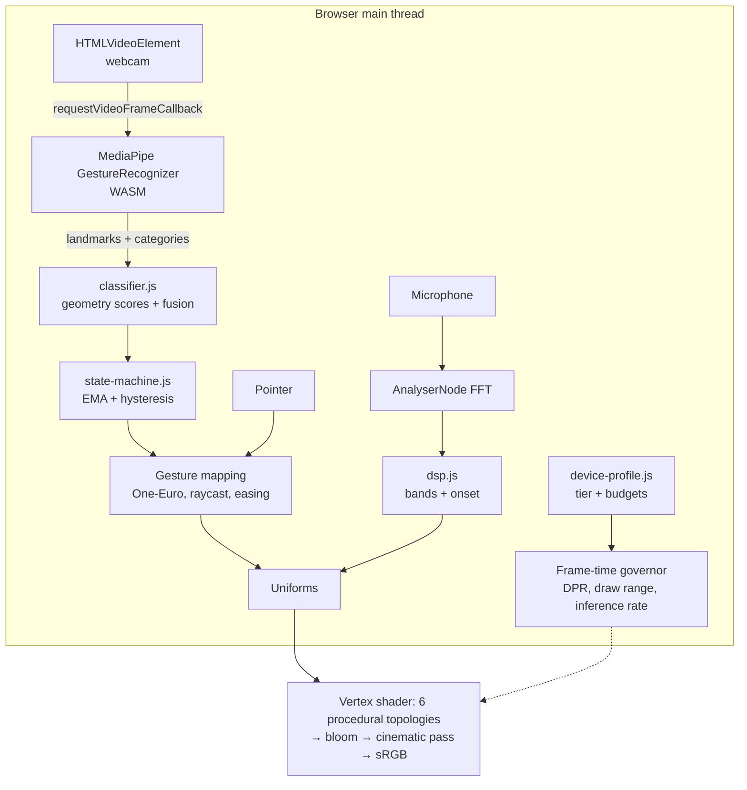

# Quantum Singularity: Architecture

## 1. System overview

Quantum Singularity is a static WebGL 2 application written as native ES modules with no build step. Three input channels (pointer, hand gestures, microphone) are reduced to a small set of shader uniforms. The GPU computes every particle from those uniforms each frame.

### Module map

| Module | Role | Depends on |
| :--- | :--- | :--- |
| `src/main.js` | Composition root: renderer, composer, UI, camera and microphone lifecycles, render loop, test surfaces | everything below, Three.js, MediaPipe |
| `src/core/math.js` | `clamp`, `lerp`, `approach` (frame-rate-independent exponential easing), `OneEuroFilter`, `createLcg` | none |
| `src/core/device-profile.js` | `classifyGPU`, `pickTier`, `computeQualityProfile`, `parseQualityOverride` | none |
| `src/gesture/classifier.js` | `geometryGestureScores`, `mediaPipeGestureScores`, `fuseGestureScores` | `core/math` |
| `src/gesture/state-machine.js` | `createGestureStateMachine`, `GESTURE_THRESHOLDS` | `core/math` |
| `src/audio/dsp.js` | `computeAudioBandBins`, `computeAudioBands`, `detectAudioOnset` | `core/math` |
| `src/state/share-link.js` | `serializeShareState`, `parseShareHash` | none |
| `src/render/shaders/*` | GLSL sources as string exports | none |

The rule is to push side effects to the edges. Everything except `main.js` is free of DOM and Three.js, so the logic is unit-tested directly in Node (`tests/unit/`). The same functions are also exposed to browser tests as `window.__qsGesture` and `window.__qsAudio`.

---

## 2. Rendering

- **Renderer**: Three.js 0.185.1 `WebGLRenderer` on a WebGL 2 context. The particle material uses GLSL ES 1.00-style `ShaderMaterial`; the post pass is GLSL 3.
- **Procedural particles**: the geometry has no position buffer, only `aIndex` (shuffled, normalised index), `aSeed` and `aPolarity`. The vertex shader evaluates the current topology, and during a morph the next one too, then applies curl noise, tilt, spin, the hand attractor and audio modulation. Shapes 2 to 6 are scaled by fixed framing factors so each fills the frame at the default camera distance.
- **Index shuffle**: a seeded Fisher-Yates shuffle (LCG seed `0x9e3779b9`) decorrelates buffer order from radius, so `setDrawRange` trimming thins the field uniformly.
- **Topologies**:
  1. Singularity accretion: golden-angle disk with jets
  2. Quantum lotus: Fibonacci sphere with 7-fold petals
  3. 4D tesseract: 16 hypercube vertex groups rotated in x-w and y-w, perspective-projected
  4. Clifford attractor: a stylised closed form
  5. Hopf fibration: stereographic projection of S³ fibres
  6. Lorenz manifold: closed-form wing parametrisation (no ODE integration)

  Formulas are in [llms-full.txt](./llms-full.txt).
- **Post-processing**: `RenderPass` → `UnrealBloomPass` (disabled when strength ≈ 0) → cinematic `ShaderPass` (aspect-correct chromatic aberration and vignette, gamma-space grain skipped when grain ≈ 0) → `OutputPass`. Composer targets are 8-bit on every tier: the additive particle shading is authored to saturate at display white, and half-float targets let dense regions sum far past it, which washed the disk out. `UnrealBloomPass` keeps its own half-float mip chain. Point size is multiplied by `sqrt(28000 / drawnCount)` above 28K particles (`pointSizeCompensation` in `core/device-profile.js`), so screen coverage does not grow with the tier.
- **Point size**: `projectionMatrix[1][1] × viewport height`, so perspective scaling tracks the field of view and the window.
- **Fragment shader**: no `discard`. Every falloff reaches zero at the sprite edge, so the additive write is a no-op and early-Z and framebuffer compression stay enabled on tile-based GPUs.

### Quality tiers

| Tier | Chosen when | Desktop / mobile particles | DPR cap | Inference cap |
| :--- | :--- | ---: | ---: | ---: |
| minimal | software renderer; or ≤ 2 GB memory with ≤ 2 cores; or Data Saver on mobile | 28,000 / 18,000 | 1.0 | 12 Hz |
| low | integrated GPU, ≤ 4 GB memory, ≤ 4 cores, or Data Saver | 48,000 / 30,000 | 1.25 / 1.15 | 18 / 20 Hz |
| medium | otherwise | 82,000 / 52,000 | 1.75 / 1.6 | 26 / 20 Hz |
| high | discrete GPU (or an unreported GPU with ≥ 10 cores) not ruled out above | 110,000 / 52,000 | 2.0 / 1.6 | 26 / 20 Hz |

At runtime a governor compares the measured frame time with the target (58 FPS on desktop, 50 on mobile and minimal). It steps the pixel ratio and the draw range, with a dead zone and a cooldown, and lowers the inference rate (down to 8-9 Hz on the minimal tier) when frames are slow. `?quality=` pins a tier and disables the governor. Render targets are reallocated once per quality step.

---

## 3. Gesture pipeline

- **Scheduling**: `requestVideoFrameCallback` drives `recognizeForVideo` on new camera frames, rate-limited by the governor. Media timestamps are rebased onto `performance.now()` and kept strictly monotonic.
- **Model**: `gesture_recognizer.task` (float16). The camera permission is requested before the model downloads. The model is validated by its file signature (`TFL3` or ZIP) and a size floor, then cached in CacheStorage. A cached file that fails validation is evicted.
- **Geometry classifier**: branch-free joint angles, PIP/DIP straightness (`EXT_UNKNOWN = 0.5` for occluded joints) and palm-basis normal quality `q`, scored for `Pointing_Up`, `Open_Palm` and `Victory`. It is scale-invariant and tolerates malformed input.
- **Fusion**: `wGeom = 0.30 + 0.16q`. Three conditions can raise the score:
  - both classifiers agree
  - the model is highly confident
  - the geometry is unambiguous on a well-presented palm

  A `None` veto comes from the model, or from canned negative labels (fist, thumbs up or down, "I love you").
- **Temporal state machine**: asymmetric EMA (τ 45 ms attack, 130 ms release). Activation needs a score ≥ 0.64 with a 0.09 lead, held for 85 ms. A switch needs ≥ 0.74 and a 0.10 margin over the incumbent. Release comes after 200 ms below 0.44, accumulated independently of the challenger, so a flickering challenger cannot block release. Each sample contributes at most 64 ms (0.75 × 85 ms) toward confirmation, so two agreeing samples are always required, even at 8 Hz.
- **Mappings**: the `Pointing_Up` fingertip is raycast onto a camera-facing plane through `orbit.target` (aspect-correct, mirrored NDC). `Open_Palm` maps apparent hand size in image space to orbit radius. `Victory` maps horizontal hand position to Chaos (0-2).

---

## 4. Audio pipeline

- `getUserMedia({ audio: true })` → `MediaStreamAudioSourceNode` → `AnalyserNode` (`fftSize = 1024`, `smoothingTimeConstant = 0`). Smoothing is done on the CPU with frame-rate-independent easing.
- `computeAudioBandBins` maps sample rate and FFT size to four bands once per stream: sub-bass 20-80 Hz, mid-bass 80-250 Hz, mids 250-2000 Hz, treble 2-8 kHz. `computeAudioBands` averages them each frame into a caller-owned object, with no allocation.
- `detectAudioOnset`: a pulse fires when `bass > 1.4 × slowAverage + 0.05`, with a 140 ms cooldown, so detection adapts to the track's loudness.
- Uniforms:
  - `uAudioBass` (55 % sub-bass, 45 % mid-bass) swells the field radially.
  - `uAudioMid` rotates hue.
  - `uAudioTreble` scales curl turbulence and particle energy.
  - `uAudioPulse` flashes energy and bloom.
- **Lifecycle parity with the camera**:
  - a session counter guards against stale enable/disable races
  - every `getUserMedia` failure has a named error message
  - both streams are fully stopped on tab hide and re-acquired only if they were live
  - both are torn down on unload and when the page enters the bfcache

---

## 5. Interface

- **First run**: the field is shown first. A non-modal welcome card offers the two ways in ("Enable hand control" and "Explore with mouse") plus a link to the full guide. It never takes focus, and any choice, `Esc`, `H` or the camera button dismisses it for good.
- **Guide (`H`) and Build notes (`B`)**: modal dialogs with a shared focus trap, an `inert` background, mutual exclusion and focus restoration.
- **Stats (`P`)**: `GPUTimer` wraps `EXT_disjoint_timer_query_webgl2` with two-deep pipelined queries, so a result is never awaited synchronously. `renderer.info.autoReset` is disabled and reset once per frame, so the draw-call count covers every composer pass.
- **Share links (`C`)**: scene state serialises to `#t=…&p=…&sc=…`. Parsing validates each key independently, so an absent topology never resets the scene.

---

## 6. Delivery and security

- **Static files only**: no Functions, Middleware or server-side code. Three.js and MediaPipe load directly from pinned CDN versions rather than being proxied.
- **Import map with SRI**: all 9 import-map modules carry `sha384` integrity: Three.js core, 6 addons, and MediaPipe's `vision_bundle.mjs` from jsdelivr and an unpkg fallback. The static audit fails if a reachable import has no hash. Enforcement requires Chrome 127+, Firefox 138+ or Safari 18.4+; older browsers ignore the integrity map.
- **Strict CSP**: `script-src` has no `'unsafe-inline'`. The app moved from one inline module to `src/`, which left the import map as the only inline script. Because it changes only when a dependency does, it is allowed by its SHA-256, and the static audit recomputes the hash so an edited import map cannot silently blank the production site. The async web-font `onload` trick was replaced with a plain stylesheet link, because inline event handlers are blocked. `tests/csp.spec.ts` boots the whole app under the exact production headers and fails on any `securitypolicyviolation`; a negative control with a corrupted hash fails as expected.
- **Other headers**: HSTS (2 years), `nosniff`, `X-Frame-Options: DENY`, COOP `same-origin`, `Referrer-Policy`, and a Permissions-Policy restricting camera and microphone to this origin.
- **Deploy set**: `.vercelignore` excludes tests, scripts, tooling and `docs/`. The static audit checks that nothing the site links to, including the markdown docs advertised in `llms.txt`, is excluded.
- **PWA**: `manifest.json` with maskable 192 and 512 icons and an apple-touch-icon.

---

## 7. Testing

See [VALIDATION.md](./VALIDATION.md). There are three layers, all gated in CI:
- an 11-check static audit
- 137 Node unit tests with coverage thresholds
- 91 Playwright browser tests on headless Chromium with SwiftShader
