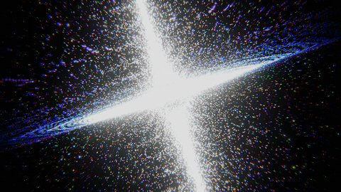
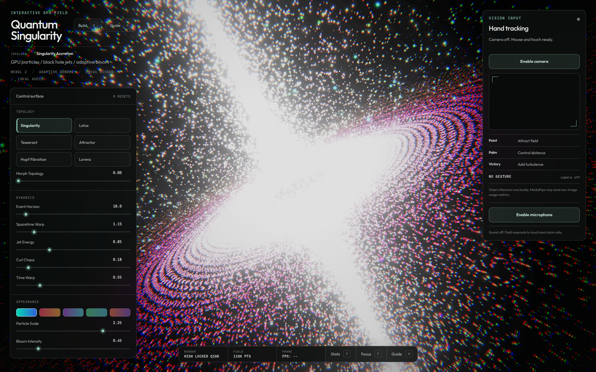
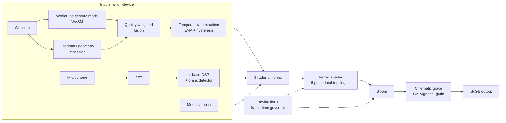

<div align="center">

# Quantum Singularity

**A particle field you play with your hands.**

Up to 110,000 GPU particles that follow your gestures through the webcam, pulse with your music,<br>
and drift under your mouse, all computed in the browser and with nothing uploaded.

[**▶ Open the live demo**](https://quantumsingularity.vercel.app/) &nbsp;·&nbsp; [How it works](#how-it-works) &nbsp;·&nbsp; [Architecture](./ARCHITECTURE.md) &nbsp;·&nbsp; [Validation report](./VALIDATION.md)

[](https://github.com/Ibrahim-Salman19/quantum-singularity/actions/workflows/ci.yml)
[](./LICENSE)




<sub>720p loop: <a href="./docs/media/hero.mp4">MP4</a> · <a href="./docs/media/hero.webm">WebM</a></sub>

</div>

---

## Try it in 30 seconds

1. **Open the [live demo](https://quantumsingularity.vercel.app/)** and move your mouse (or drag a finger). The field bends toward you.
2. **Click "Enable hand control"** and raise a hand to the webcam:

   | Gesture | Effect |
   | :--- | :--- |
   | ☝️ Point | Pull particles toward your fingertip |
   | ✋ Open palm | Move your hand closer or further to zoom |
   | ✌️ Victory | Slide sideways to add turbulence |

3. **Click "Enable microphone"** and play some music. Bass swells the field, mids shift its colour, treble roughens it and every beat flashes it.
4. **Press `1`-`6`** to morph between six mathematical shapes, `F` for a clean full-screen view and `H` for the guide.

Camera and microphone are opt-in. Video and audio are analysed on your device and never leave the browser.



---

## Highlights

| | |
| :--- | :--- |
| **On-device ML, fused with geometry** | MediaPipe's gesture model is blended with a hand-written landmark classifier, weighted by how well the palm faces the camera, then debounced by a time-based state machine. |
| **Zero CPU particle work** | The particle field has no position buffer. Every position is computed in the vertex shader from a shuffled index, so the CPU uploads nothing per frame. |
| **Frame-rate independent everywhere** | Smoothing, debouncing and easing run on elapsed seconds, not frame counts, and behave the same at 30 Hz and 144 Hz. This is pinned by tests at 30/60/120/144 Hz. |
| **Adapts to the device** | GPU and device probing picks a tier at boot (software renderer, integrated or discrete GPU), then pixel ratio and particle count follow the measured frame time. |
| **Tested like a product** | 137 unit tests (99.8 % line coverage of the logic modules), 91 browser tests in headless Chromium, and an 11-check static audit, all gated in CI. |
| **Locked-down delivery** | Strict CSP with no `'unsafe-inline'` script, SRI hashes on every CDN module, HSTS and a same-origin camera/microphone policy. A browser test boots the app under the exact production headers. |
| **No build step** | Native ES modules and an import map. The repository is the deployable site. |

---

## How it works



All three inputs end up as a handful of uniforms on one shader. The CPU's job each frame is to update those uniforms; the GPU computes every particle from scratch.

### Engineering notes

**Positions are never computed on the CPU.** Each particle carries only a shuffled index, a seed and a jet polarity. The vertex shader turns these into a position for the current topology, morph progress, gravity, chaos, hand attractor and audio level. Dropping the usual `N × 3` position buffer removed 1.3 MB of data that was being bound on every draw.

**Quality reductions are invisible.** Every topology maps index to radius monotonically, so trimming the draw range under load used to cut the outer edge off the disk. The index buffer is shuffled once with a seeded Fisher-Yates, which decorrelates buffer order from position: drawing fewer particles now thins the field evenly.

**Gesture recognition fuses two independent signals.** The neural classifier is accurate on canonical poses but knows only a fixed label set. The geometric classifier (joint angles, finger straightness, palm-normal quality) is orientation-invariant and degrades gracefully. They are blended with a weight that tracks how reliably the palm normal can be estimated, then pass through a state machine with separate activate, switch, hold and release thresholds. A one-frame spike cannot trigger a gesture, and a flickering challenger cannot block a release.

**Low frame rates were a real failure mode, found by tests.** On the weakest devices inference drops to 8 Hz, so one sample spans 125 ms, longer than the 85 ms confirmation window. A single misclassified frame after a pause could therefore confirm a gesture on its own. Each sample's contribution is now capped, so confirmation always needs two agreeing samples, and a test pins the behaviour at 8 Hz.

**Audio uses an adaptive noise floor.** Band boundaries (80 / 250 / 2000 / 8000 Hz) are mapped to FFT bins once per stream. Beat detection compares bass energy to a slow running average of itself, so it works on a quiet podcast and a loud track without a sensitivity slider.

**Correctness details that only show up under scrutiny:**
- **Golden angle.** The phyllotaxis spiral uses the true golden angle, 2.39996 rad. It used to scale 137.5° by τ, a different constant, which produced a subtly wrong spiral.
- **Film grain.** Grain is applied in gamma-encoded space. Added to linear values, it turned into blocky noise in the shadows after the sRGB encode.
- **Brightness that scales with the GPU.** Particles blend additively, so a bigger particle budget used to mean more light: the 82K and 110K tiers summed the inner disk to many times display white on half-float targets, and it rendered as a flat white glow. Composer targets are now 8-bit on every tier, and point size shrinks with the square root of the drawn count so screen coverage stays constant. A faster GPU now buys finer detail, not a brighter blur.
- **Draw-call counter.** `EffectComposer` renders once per pass, and `renderer.info` resets on each render, so the naive draw-call readout showed only the last pass (1 instead of 17). The render loop now owns the reset.
- **Point size.** Point size comes from the projection matrix and the drawing-buffer height, so perspective scaling tracks the field of view and the window size.

The in-app **Build** panel (`B`) and **Stats** readout (`P`, which shows GPU time and draw calls) present the same material to visitors who never open the source.

---

## Reliability

| Layer | What runs | Where |
| :--- | :--- | :--- |
| **Static audit** | 11 checks: JS syntax, module graph (imports resolve to real exports), unique DOM IDs, every `getElementById` target exists, SRI coverage of every CDN import, strict-CSP hash of the import map, topology bindings, and that every deployed reference exists and is not excluded from the deploy | `npm run test:static` |
| **Unit** | 137 tests on the pure logic modules (gesture classifier, fusion and state machine, audio DSP, device tiering, share links, maths), with coverage thresholds enforced: 99.8 % lines, 94.6 % branches, 100 % functions | `npm run test:unit` |
| **Browser** | 91 Playwright specs on headless Chromium with SwiftShader: real camera pipeline with a fake device, shader compilation, an exposure check that fails if the largest tier renders white, modal focus traps, keyboard map, first-run flow, tab-hide teardown, and the full app under the production CSP | `npm run test:e2e` |

CI runs the audit and unit tests first, then the browser suites in parallel. Writing the unit layer found real bugs, each now pinned by a regression test:

- **The 110,000-particle tier was unreachable in every Chromium browser.** Chrome caps `navigator.deviceMemory` at 8, and the tier check required more than 8.
- **Every Firefox and Safari visitor was classed as low-end.** Those browsers hide `deviceMemory`, and the missing value defaulted to 4 GB.
- **Every Linux desktop with an Intel or AMD GPU got the lowest tier.** The software-renderer pattern matched "Mesa", the standard Linux driver stack.
- **At 8 Hz inference, a single misread frame could trigger a gesture.** The fix is described in the engineering notes above.
- **Shared links without a topology reset the scene to the first shape.** `Number(null)` is 0, which passed the range check.

[VALIDATION.md](./VALIDATION.md) has the details.

---

## Run it locally

No build step and no runtime dependencies. Any static file server works:

```bash
git clone https://github.com/Ibrahim-Salman19/quantum-singularity.git
cd quantum-singularity
npm start                       # python3 -m http.server 8080 → http://localhost:8080
```

To run the tests (Node ≥ 22.8):

```bash
npm ci
npx playwright install chromium
npm test                        # static audit + unit tests + browser suite
npm run test:unit               # fast: logic only, with coverage
```

**Quality override.** Add `?quality=minimal|low|medium|high` to the URL to pin a tier and disable adaptive quality. This is useful on a weak machine, or to see the full 110,000-particle field on a strong one.

**Share a scene.** Press `C` to copy a link that restores the current shape, palette and slider values.

<details>
<summary><b>Project structure</b></summary>

```
index.html                 markup, import map (SRI-pinned), metadata
src/
  main.js                  app wiring: renderer, UI, camera/mic lifecycles, render loop
  styles.css
  core/math.js             frame-rate-independent easing, One-Euro filter, seeded LCG
  core/device-profile.js   GPU/device classification → quality tier and budgets
  gesture/classifier.js    landmark geometry scoring + neural/geometry fusion
  gesture/state-machine.js EMA + hysteresis gesture debouncer
  audio/dsp.js             FFT band mapping, band levels, onset detection
  state/share-link.js      URL-hash scene serialisation and validation
  render/shaders/          particle field and cinematic post-processing GLSL
tests/
  unit/                    node --test suites for every src/ logic module
  fixtures/hand-poses.mjs  synthetic 21-landmark hand poses
  *.spec.ts                Playwright browser suites
scripts/
  static_audit.js          pre-test static checks
  capture-media.mjs        regenerates the README media deterministically
vercel.json                security headers (CSP, HSTS, Permissions-Policy)
```

Every module in `src/` except `main.js` is pure, with no DOM access and no Three.js dependency, so the logic that matters is tested directly in Node rather than through a browser.
</details>

---

## Privacy, security and accessibility

- **Privacy.** Camera and microphone are requested only on an explicit click, the camera before the ML model downloads, so declining costs nothing. Frames and audio are processed locally. Both streams stop when the tab is hidden and resume only if they were on. The app sets no cookies and runs no analytics (the in-app note discloses that the MediaPipe library may send non-image usage metrics).
- **Network.** Three.js and MediaPipe load from pinned CDN versions, each module checked against a `sha384` hash. The gesture model is downloaded from Google's model storage once, validated by its file signature and cached.
- **Headers.** A strict Content-Security-Policy (the single inline script, the import map, is allowed by its SHA-256), HSTS, `nosniff`, `X-Frame-Options: DENY` and a Permissions-Policy limiting camera and microphone to this origin.
- **Accessibility.** Everything is reachable from the keyboard. Modals trap and restore focus with an `inert` background. The app respects `prefers-reduced-motion` and `prefers-reduced-transparency`.
- **Resilience.** The app degrades gracefully without WebGL 2 or float render targets, or with a GPU timer, a CDN, a camera or `localStorage` missing. It also survives WebGL context loss and restore.

**Requirements:** a browser with WebGL 2 and import maps (any current Chrome, Edge, Firefox or Safari). Hand tracking needs a webcam, and hardware acceleration is strongly recommended. The CI suite runs on Chromium.

---

## Keyboard

| Key | Action | Key | Action |
| :--- | :--- | :--- | :--- |
| `1`-`6` | Switch topology | `F` | Focus mode |
| `H` | Guide | `B` | Build notes |
| `P` | Performance stats | `C` | Copy share link |
| `R` | Reset controls | `Space` | Pause |
| `Esc` | Close panel | | |

---

## License

[MIT](./LICENSE) © Ibrahim Salman. Built with [Three.js](https://threejs.org/) and [MediaPipe](https://ai.google.dev/edge/mediapipe/solutions/vision/gesture_recognizer).

<sub>Machine-readable summaries for AI agents: [`llms.txt`](https://quantumsingularity.vercel.app/llms.txt) · [`llms-full.txt`](https://quantumsingularity.vercel.app/llms-full.txt)</sub>
